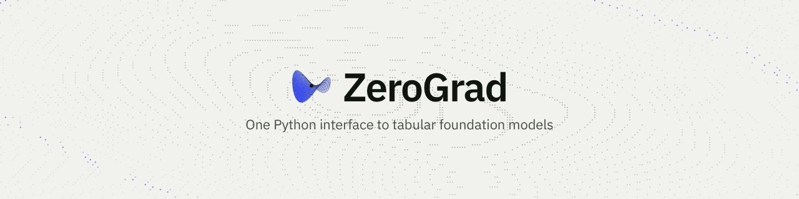
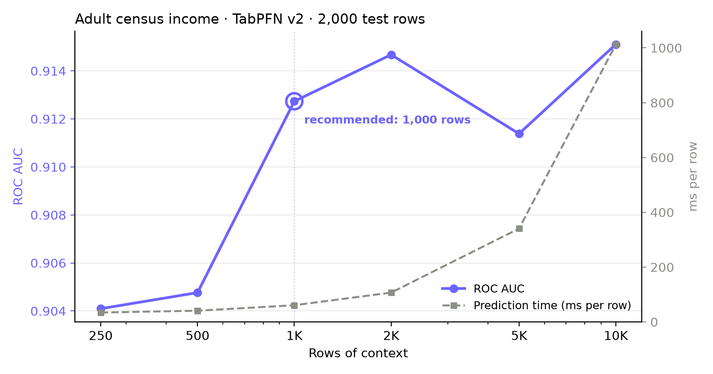

<p align="center">
  <picture>
    <source media="(prefers-color-scheme: dark)" srcset="docs/banner-dark.gif">
    <source media="(prefers-color-scheme: light)" srcset="docs/banner-light.gif">
    
  </picture>
</p>

<p align="center">
  <a href="https://pypi.org/project/zerograd/"></a>
  <a href="https://github.com/zerogradlabs/zerograd-python/actions/workflows/ci.yml"></a>
  <a href="LICENSE"></a>
  <a href="https://colab.research.google.com/github/zerogradlabs/zerograd-python/blob/main/examples/quickstart.ipynb"></a>
</p>

## Tabular foundation models

The usual way to predict something from a table (churn, fraud, default, demand) is to train a model for that
problem: pick an algorithm, tune it, validate it, retrain it when the data changes.

Tabular foundation models work differently. They are pretrained once, on millions of synthetic datasets, to learn
*in context*: you give them your labeled rows as context and they predict new rows in a single forward pass, with no
training and no hyperparameters. On small and medium tables they are competitive with tuned gradient boosting.

Several research groups have released them: TabPFN (Prior Labs), TabICL (Inria), Mitra (Amazon), TabDPT (Layer 6)
and others. Each comes with its own package, checkpoints, preprocessing and license.

## What ZeroGrad does

ZeroGrad puts them behind one interface. The same two calls, `create` and `predict`, work with every model, on your
machine or on the ZeroGrad platform. On top of that:

* **A championship instead of a guess.** Which model is best depends on the data. ZeroGrad scores every model on the
  same holdout of your rows and keeps the best one as the champion, with the comparison in a table.
* **Licenses you can see.** Some models allow commercial use and some do not. `zerograd.list_models()` shows each
  license and where the weights come from; non-commercial models stay off unless you enable them by name.
* **Local or cloud, same code.** Locally, nothing leaves your machine. With `remote=True` the same capability runs on
  the platform, with versions, scheduled championships, monitoring and batch pipelines.

## Quickstart

```bash
pip install zerograd
```

```python
from zerograd import ZeroGrad

zg = ZeroGrad()                                        # local: runs on your machine
cap = zg.create("churn", examples=history, target="churned")
cap.evaluation                                         # every model on the same holdout; the champion is marked
cap.predict(new_customers)                             # prediction, score and probability per class
```

<p align="center"></p>

Open source under Apache 2.0. Try it without installing anything, in Colab:

| Notebook | What it shows | |
|---|---|---|
| [Quickstart](examples/quickstart.ipynb) | Model catalog, a championship on breast cancer data, predictions, saving, and a context curve on Adult | [Open in Colab](https://colab.research.google.com/github/zerogradlabs/zerograd-python/blob/main/examples/quickstart.ipynb) |
| [Titanic](examples/titanic.ipynb) | A championship you check against your own holdout, one-row predictions, how much history you need, multiclass | [Open in Colab](https://colab.research.google.com/github/zerogradlabs/zerograd-python/blob/main/examples/titanic.ipynb) |

## Install

```bash
pip install zerograd                  # local engine with TabPFN v2 and TabICLv2
pip install "zerograd[all]"           # adds Mitra-v2 and TabDPT
```

Python 3.10+. A GPU helps but is not required: on CPU, histories up to a few thousand rows take seconds to
minutes. Weights download from each model's official Hugging Face repository the first time you use it and
are cached there (`HF_HOME`); ZeroGrad hosts none.

## What models are there?

```python
import zerograd

zerograd.list_models()                                  # every model: tasks, license, commercial use, installed
zerograd.list_models(task="classification", commercial=True)
zerograd.list_tasks()                                   # every task and which models do it
zerograd.list_models().to_frame()                       # as a DataFrame
```

In a notebook these render as tables with a badge for commercial and non-commercial use. In this version:

| Model | Name | License | Commercial use | Default |
|---|---|---|---|---|
| TabPFN v2 | `tabpfn-v2` | Prior Labs License (Apache 2.0 + attribution) | yes | yes |
| TabICLv2 | `tabicl-v2` | BSD-3-Clause | yes | yes |
| Mitra-v2 | `mitra-v2` | Apache 2.0 | yes | yes, with `pip install "zerograd[mitra]"` |
| TabDPT | `tabdpt` | Apache 2.0 | yes | yes, with `pip install "zerograd[tabdpt]"` |
| Mitra | `mitra` | Apache 2.0 | yes | by name |

The full list, with sources and the models that are off by default, is in [MODELS.md](MODELS.md).
This version runs **classification** (binary and multiclass, up to 10 classes) and **regression** (locally, with
TabPFN v2, TabICLv2 and TabDPT). `zerograd.list_tasks()` shows which models run each task.

## The championship

```python
cap = zg.create(
    "titanic-survival",
    examples="train.csv",          # a DataFrame or a CSV/Parquet path
    target="Survived",
    drop=["boat", "body"],         # columns only known after the outcome
    metric="roc_auc",              # or pr_auc, log_loss, accuracy, balanced_accuracy, f1, precision, recall, f1_macro
)
cap.evaluation       # one row per model: metrics on the holdout, seconds, champion
cap.baselines        # the same holdout scored without a model (random, majority class)
cap.columns          # which columns were used and why the others were dropped
```

What happens:

* Columns that cannot help are dropped and reported: identifiers, free text, constant and empty columns.
* 20% of the labeled rows are held out (stratified) and every holdout row is scored by every model.
* The context the models read is the rest, or a stratified sample of up to 10,000 rows.
* The champion keeps a context drawn from all labeled rows for predictions.

Pick the competitors with `ZeroGrad(models=["tabpfn-v2", "mitra-v2"])`.

## Benchmark

We ran 12 OpenML classification datasets and 6 regression datasets, 3 seeds each, on GitHub Actions CPUs. The champion
is picked on the training rows only, and every number below comes from a 20% test split that nothing saw during
selection. The baseline is scikit-learn's HistGradientBoosting with default settings, and regression also gets Ridge
as a linear baseline.

| | champion against HistGradientBoosting (wins / ties / losses) |
|---|---|
| ROC AUC | 11 / 0 / 1 (mean 0.894 against 0.866) |
| Log loss | 12 / 0 / 0 (0.323 against 0.454) |
| Brier score | 12 / 0 / 0 |
| Accuracy | 10 / 1 / 1 |
| Regression RMSE | 6 / 0 / 0 (and 6 / 0 / 0 against Ridge) |

The one loss is churn, by 0.004 of ROC AUC: TabPFN v2 alone would have won it, but the championship picked another
model on the training rows. Gradient boosting is much faster, though: a fit and predict takes it well under a second,
while the champion's number (about 6 minutes on average on CPU) includes running the whole championship of four
models. Per-dataset tables for every model are in [benchmarks/RESULTS.md](benchmarks/RESULTS.md), and
`python benchmarks/run.py` reproduces them.

## Predict

```python
preds = cap.predict(new_df)            # DataFrame aligned to new_df's index
cap.predict({"Pclass": 3, "Sex": "male", "Age": 22, "Fare": 7.25})   # one row -> dict
cap.update(threshold=0.3)              # binary: score >= 0.3 predicts the positive class
```

## Context size: speed against quality

Foundation models read their context (your labeled rows) on every prediction, so more rows usually score better
and answer slower. `context_curve` fits one model on growing samples of the context, scores each on the same test
rows and times it:

```python
curve = zg.context_curve(train_df, "Survived", test=test_df)   # sizes: 250, 500, 1K, 2K, 5K, 10K... up to all rows
curve                    # per size: the metric, fit and predict seconds, ms per row, and the recommended size
curve.recommended        # the smallest context within 0.005 of the best score (tolerance=...)
curve.plot()             # score and latency on two axes, the recommended size marked (needs matplotlib)

curve = cap.context_curve(test_df)               # the champion, on samples of the capability's own context
cap.update(context_rows=curve.recommended)       # predict with the smaller, faster context
```

<p align="center"></p>

On 12,000 rows of the Adult census (TabPFN v2 on a GitHub Actions CPU, 2,000 test rows), 1,000 rows of context score
ROC AUC 0.913 against 0.915 with 10,000, and predict about 17× faster (61 vs 1,012 ms per row).
`python scripts/context_curve_figure.py` reproduces it; [docs/context-curve.csv](docs/context-curve.csv) has the numbers.

Options: `sizes=[...]`, `model="tabicl-v2"` (default: the first selected model), `metric="log_loss"`, `tolerance=0.01`.
Without `test`, a stratified 20% of the rows is held out. With `remote=True` the curve runs a championship per size
on the platform and returns the same kind of table.

## Regression

A numeric target with decimals, or with more distinct values than classes allowed (10), is a regression:

```python
cap = zg.create("prices", examples=listings, target="price")   # or task="regression" to say so
cap.evaluation       # RMSE, MAE and R² per model on the same holdout; the champion has the lowest RMSE
cap.baselines        # always the average, always the median
cap.predict(new_listings)                    # one column: prediction
cap.predict(one_listing)                     # a dict in, {"prediction": 154230.5} out
```

`metric="mae"` or `metric="r2"` picks the champion by another metric. The holdout and the context are stratified on
deciles of the target, so both see cheap and expensive rows. Context curves work the same way; for RMSE and MAE the
tolerance is relative (within 0.5% of the best). Mitra-v2 sits regression out in this version, and the platform
(`remote=True`) runs classification only for now.

## Save and open

```python
cap.save("titanic.zg")                 # preprocessing, evaluation and context rows; no weights
cap = zerograd.load("titanic.zg")
```

The file holds a sample of your labeled rows as the model's context: treat it like the data itself.

## Licenses and attribution

The SDK is Apache 2.0. Each model has its own license, shown by `zerograd.list_models()`, and **you are
responsible for complying with it** ([TERMS.md](TERMS.md)). If you build a product with TabPFN v2, its license
asks you to show **"Built with PriorLabs-TabPFN"**; `cap.attribution` tells you when the champion needs it.

Some newer models are released under non-commercial licenses. They are off by default, can be enabled one by
one by name for research and evaluation, and never run on the ZeroGrad platform. See
[MODELS.md](MODELS.md#non-commercial-off-by-default-research-and-evaluation-only) and [TERMS.md](TERMS.md).

## Bring your own model

Anything with `fit` and `predict_proba` can compete (and with `predict`, in regression):

```python
from zerograd.models import Aligned, ModelSpec, register_model

def fit(X, y, n_classes, serving):
    model = MyClassifier().fit(X, y)
    return Aligned(model, n_classes)

register_model(ModelSpec(
    name="my-model", display="My model", family="mine", license="MIT", license_url="https://...",
    source="local", commercial=True, install="-", fit_fn=fit, check_fn=lambda: None,
    regress_fn=lambda X, y, serving: MyRegressor().fit(X, y),   # optional: also compete in regression
))
ZeroGrad(models=["tabpfn-v2", "my-model"])
```

## The ZeroGrad platform (`remote=True`)

The same calls run on the ZeroGrad platform with an API key:

```python
zg = ZeroGrad(remote=True)             # reads ZEROGRAD_API_KEY; an API key alone also selects it
cap = zg.create("churn", examples=history, target="churned")
```

The platform adds what a team needs to run predictions in production: managed GPU inference with SLAs, versions and promotion, scheduled
championships on fresh history, batch pipelines from your bucket, monitoring, thresholds chosen by cost,
Explain and Ask, and workspaces for teams. `zerograd.privacy` (`scan`, `drop_sensitive`, `Vault`) keeps
personal data on your side before anything is sent. See [zerograd.dev](https://zerograd.dev).

`remote=None` (the default) picks the platform when an API key is given or `ZEROGRAD_API_KEY` is set;
pass `remote=False` to stay local.

## Output

The SDK talks on stderr: a greeting, a spinner per model, a podium at the end. Off a terminal (CI, logs) it prints
plain lines; `progress=False` or `ZEROGRAD_QUIET=1` silences it, and `NO_COLOR` turns colors off. License warnings
are never silenced.

## Development

```bash
pip install -e ".[dev]"
pytest                                        # fast tests, no models, no network
ZEROGRAD_REAL_MODELS=1 pytest tests/test_real_models.py   # the real models (downloads weights)
```

## Security

See [SECURITY.md](SECURITY.md). Releases are published from GitHub Actions with PyPI trusted publishing.

## License

Apache License 2.0. See [LICENSE](LICENSE) and [NOTICE](NOTICE). The models have their own licenses: [MODELS.md](MODELS.md).
